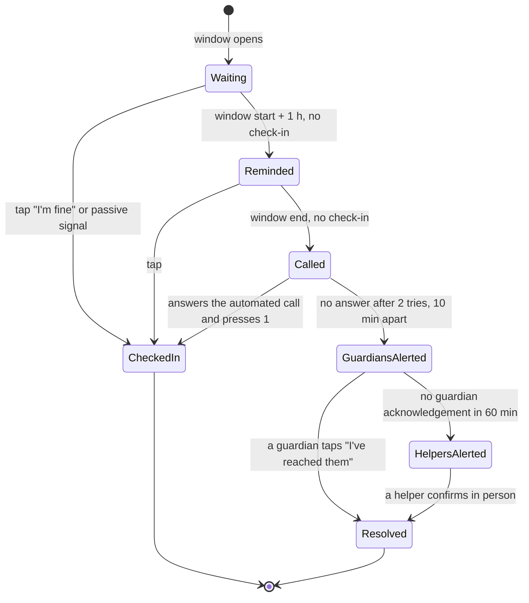
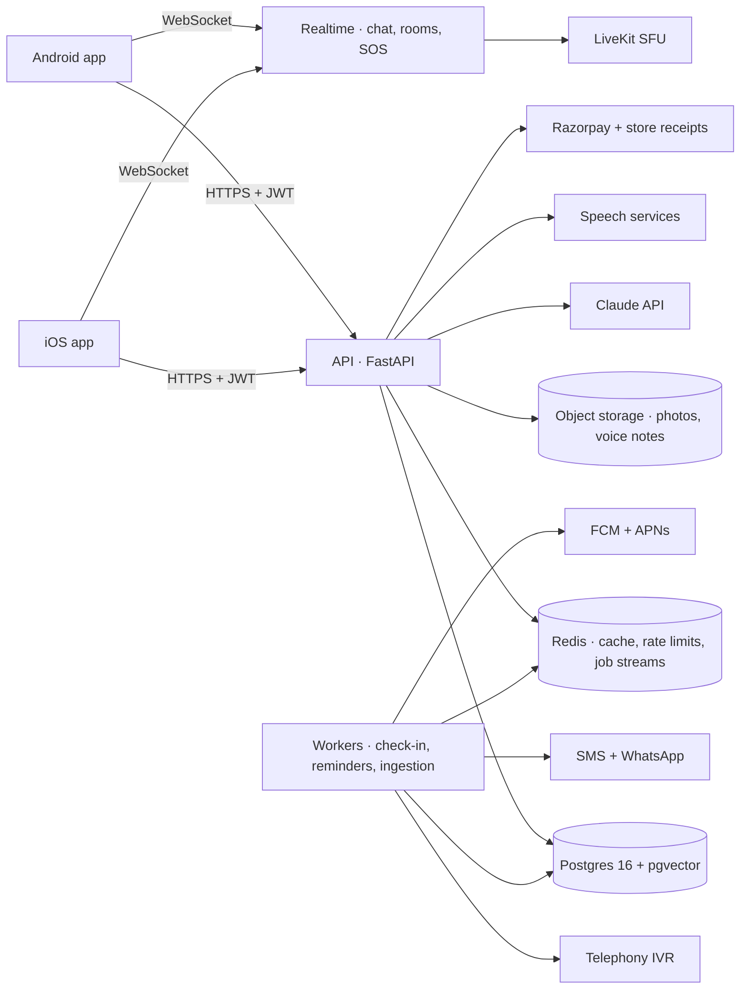

# Doosri Pari — Product and Build Plan

**The second innings app for India's retired government employees and pensioners**

| | |
|---|---|
| File | DP/PLAN/2026/02 |
| Version | 2.0 · 29 September 2026 |
| Owner | Rachit Chaturvedi |
| Platforms | Android and iOS (shared Kotlin Multiplatform core, native UI on each) |
| Built on | The Moholla codebase (Android app + FastAPI backend) |
| Status | Independent app, **not** a government app |

> Retirement takes away a salary, but also a daily purpose, a routine, colleagues and the respect of being useful. Doosri Pari gives those back, and makes pension paperwork simple, safe and understood.

---

## Contents

1. [Vision and problem](#1-vision-and-problem)
2. [Who it is for](#2-who-it-is-for)
3. [Design principles](#3-design-principles)
4. [UI research and design system (Apple guidelines, minimal)](#4-ui-research-and-design-system)
5. [App structure](#5-app-structure)
6. [Feature specs](#6-feature-specs)
7. [Yoga and Spiritual Centre](#7-yoga-and-spiritual-centre)
8. [Technology: Android and iOS](#8-technology-android-and-ios)
9. [Backend architecture](#9-backend-architecture)
10. [Data model](#10-data-model)
11. [API](#11-api)
12. [Background jobs](#12-background-jobs)
13. [Non-functional needs](#13-non-functional-needs)
14. [Privacy, security and law](#14-privacy-security-and-law)
15. [Trust and moderation](#15-trust-and-moderation)
16. [Metrics](#16-metrics)
17. [Business model](#17-business-model)
18. [Launch and growth](#18-launch-and-growth)
19. [Roadmap](#19-roadmap)
20. [Testing](#20-testing)
21. [Risks](#21-risks)
22. [What Moholla gives us](#22-what-moholla-gives-us)
23. [Sources](#23-sources)
24. [Master build prompt](#24-master-build-prompt)

---

## 1. Vision and problem

**Vision.** Every retired government employee in India has a place to belong, a way to stay useful, and a trusted helper for pension matters, in their own language, on the phone they already own (Android or iPhone).

### The problem, in their words

- **"The phone stopped ringing."** After 30–40 years in an office, department or unit, the network of colleagues disappears overnight.
- **"I still know things."** Deep expertise in accounts, rules, engineering, teaching, administration and law goes unused.
- **"Nobody explains the pension rules."** DA revisions, commutation, family pension, life certificates and CGHS are confusing; answers depend on who you ask.
- **"My children live far away."** Many pensioners live alone or as a couple; families worry about emergencies and missed medicines.
- **"The calls are all frauds."** Pensioners are targeted by fake "pension office" calls, KYC scams and "job" scams.

### Success after one year

- A pensioner opens the app every morning:
  - checks in
  - sees the day's pension news
  - does 10 minutes of chair yoga
  - reads their batch circle
- Their question about DA arrears gets a correct answer that quotes the rule, in Hindi, by voice.
- They spend two hours a week mentoring a young aspirant or helping a neighbour with paperwork, and sometimes earn from it.
- Their daughter in Pune gets a quiet notification each day that her father checked in, and an alert within hours if he did not.

---

## 2. Who it is for

### Primary personas

| Persona | Background | Needs |
|---|---|---|
| **Sharma ji, 64, Lucknow** | Retired Section Officer, Indian Railways. Uses WhatsApp and YouTube. Android phone. | Misses his office, reads news every morning, confused about his last DA arrears. Hindi first. |
| **Col. (Retd.) Kaur, 58, Chandigarh** | Defence veteran on SPARSH and ECHS. iPhone user. | Fit and organised; wants to mentor, lead a veterans' walking group, do paid consulting. |
| **Savitri Devi, 71, Patna** | Family pensioner, lives alone. Low digital skill, poor eyesight. Basic Android phone. | Big text, voice, daily check-in, help with the life certificate every November. Hindi only. |
| **Mr. Iyer, 67, Chennai** | Retired state government school headmaster. iPhone (a gift from his son). | Wants to tutor, record his life story, join a Carnatic music circle. Tamil first. |

### Secondary users

- **Caregiver (adult child):**
  - installs and sets up the app for a parent
  - receives check-in and SOS alerts
  - sees medicine adherence if the parent allows
- **Association office-bearer:** runs a pensioners' association circle, posts notices, verifies members, runs events.
- **Partner organisation:** a coaching institute, NGO or company that posts vetted paid or volunteer work.
- **Volunteer helper:** a retired pension or accounts officer who answers escalated Pension Sahayak questions.
- **Admin and moderator:** the Doosri Pari team.

### Coverage

- **From day one:**
  - Central Government civil pensioners
  - Defence pensioners (SPARSH)
  - State Government pensioners, state by state
  - PSU and public-sector bank retirees
  - family pensioners
- **NPS and Unified Pension Scheme retirees:** covered in circles, community and health from day one, and in Pension Sahayak once those rules are ingested.

---

## 3. Design principles

1. **Big and calm by default.** Body text starts larger than the platform default and still grows with the system text size. Touch targets are well above the 44 pt minimum. One main action per screen.
2. **Voice everywhere.** Every search, post and question box has a microphone. Every screen has "Read this screen aloud".
3. **Mother tongue first.** The first screen asks for language, showing each name in its own script with audio.
4. **Nothing hidden.**
   - No swipe-only or long-press-only actions.
   - A visible back and home on every screen.
   - A confirmation before anything irreversible or outward: posting, calling, paying, SOS.
5. **Respect.** Address users as *ji*, show their service and rank with pride, never talk down.
6. **Trust over growth.** No dark patterns, no sale of data, clear disclaimers, and "not an official government app" shown during onboarding and in Settings.
7. **Works on a ₹8,000 phone and on older iPhones.** Android 9+ with 2 GB RAM; iOS 16+ (iPhone 8 and later); slow 4G; offline where possible.
8. **Feels native on each platform.** It follows Apple's Human Interface Guidelines on iPhone and Material conventions on Android. Brand lives in colour, illustration and tone, not in re-inventing controls.

---

## 4. UI research and design system

### 4.1 What the research says

**Apple Human Interface Guidelines** (read from developer.apple.com, September 2026):

| Topic | Apple's guidance | What we do |
|---|---|---|
| Text size | Default body text on iOS is **17 pt**, minimum **11 pt**. *"Ideally, give people the option to enlarge text by at least 200 percent."* Use Dynamic Type and the built-in text styles. | Base body is **20 pt** (one step up), built on system text styles so Dynamic Type still scales it. Tested at the largest accessibility sizes. |
| Contrast | WCAG AA as guidance: **4.5:1** for text up to 17 pt, **3:1** for larger or bold text. | We aim higher: **7:1** for body text, **4.5:1** for large text. |
| Touch targets | *"A button needs a hit region of at least 44x44 pt."* Button sizes: mini 28, small 32, regular 44, large 52, extra large 64 pt. | Minimum **56 pt** for any control; main actions use **64 pt** (extra large). |
| Tab bar | *"Use a tab bar to support navigation, not to provide actions."* Keep it visible, don't hide or disable tabs, use single-word labels, prefer filled SF Symbols, five or fewer tabs. | **Four** tabs with one-word labels. The voice mic and SOS are **not** tabs: the mic is a floating button above the tab bar, and SOS sits in the top toolbar. |
| Materials | On iOS 26 the tab bar floats on Liquid Glass above content. | Glass only on the floating navigation layer (tab bar, toolbars, the mic button). All content stays on solid, high-contrast surfaces. Reduce Transparency is respected. |

**Research on designing for older adults** (Toptal, F5 Studio, Nielsen Norman Group):

- Body text at least 16 px, respect the system font size, avoid condensed fonts and text over images.
- Always pair icons with text labels.
- One focus per screen; progressive disclosure; minimal navigation depth.
- Make "home" and "back" obvious.
- Bigger buttons with more space between them than the standard minimum.
- Avoid quick or multi-finger gestures.
- Offer voice as an alternative; caption all audio and video.
- Show progress, reminders and confirmations consistently.
- Use plain, respectful language, never a patronising tone.
- Test with real older users.

### 4.2 The look: calm, minimal, native

- **Mood:** quiet, warm, dignified. Lots of space, few elements, clear hierarchy. Think of Apple Health or Apple Books rather than a busy social app.
- **One accent colour** for the main action on each screen; everything else neutral.
- **Illustration** (the drawn instructor, the breathing orb, circle art) carries the warmth. Controls stay standard.
- **No text on photos**, no auto-playing video, no carousels for important content.

### 4.3 Design tokens

**Colour (light / dark):**

| Token | Light | Dark | Use |
|---|---|---|---|
| `background` | #FAFAF7 | #0F1414 | Screens |
| `surface` | #FFFFFF | #1A2121 | Cards, sheets |
| `ink` | #13201F | #EEF3F2 | Primary text (≥ 7:1 on background) |
| `ink-secondary` | #3F4E4C | #B8C6C4 | Secondary text (≥ 7:1) |
| `accent` | #0B6E66 (deep teal) | #6FD3C9 | Main action, selected tab |
| `marigold` | #B97700 | #F2B544 | Spiritual centre, highlights (never for body text on white) |
| `safety` | #C0311B | #FF8A73 | SOS, missed check-in only |
| `ok` | #1E7A34 | #7BD38B | "I'm fine", success |
| `divider` | #E1E7E5 | #2A3332 | Separators |

Semantic colours (safety, ok) are never used for decoration.

**Typography:**

- **iOS:** SF Pro through the system text styles. For Indic scripts the system falls back to Apple's Indic fonts; test Devanagari, Tamil and Bengali at every size.
- **Android:** Noto Sans plus the Noto Sans family for each Indic script (Devanagari, Bengali, Tamil, Telugu, Kannada, Malayalam, Gujarati, Gurmukhi), all respecting the system font scale.
- **Scale** (points on iOS, sp on Android, before Dynamic Type):

| Style | Size | Weight | Use |
|---|---|---|---|
| Large title | 36 | Bold | Screen titles ("Namaste, Sharma ji") |
| Title | 28 | Bold | Section titles |
| Headline | 22 | Semibold | Card titles |
| Body | 20 | Regular | All reading text |
| Callout | 18 | Regular | Secondary lines, button labels |
| Caption | 16 | Regular | The smallest text we use |

- No light or thin weights. Line height 1.4× for body.
- Numbers in tables use tabular figures.

**Spacing and shape:**

- A spacing scale of 4, 8, 12, 16, 24, 32 and 48. Screen side margins are 20.
- Controls at least 56 pt tall with 12 pt between them.
- Main action buttons are 64 pt tall and full width.
- Corner radius: 14 for cards and 32 for large buttons, following the platform shape language.
- Every icon is an SF Symbol (iOS) or a Material Symbol (Android) and always has a text label next to it.

### 4.4 Core components

| Component | Rules |
|---|---|
| **Primary button** | Full width, 64 pt tall, accent fill, 20 pt semibold label, icon on the left. One per screen. |
| **Secondary button** | 56 pt tall, outlined or tinted, label always visible. |
| **List row** | At least 64 pt tall: icon in a tinted rounded square, title, optional value, chevron. The whole row is tappable. |
| **Card** | Surface colour, 14 pt radius, 20 pt padding, one title, at most 3 lines of text, one action. |
| **Check-in button** | 96 pt tall, green, "Main theek hoon · I'm fine". Once pressed, "Checked in at 8:12" with a tick. |
| **SOS button** | In the top toolbar, red, labelled "SOS" (never an icon alone). Opens the hold-and-countdown screen. |
| **Mic ("Bolo") button** | A floating round button, 64 pt, above the tab bar, labelled "Bolo". Glass material on iOS 26, tonal surface on Android. |
| **Sheet** | For short tasks (a reminder, a reaction). Grabber visible, a Cancel button as well as swipe-down, medium height first. |
| **Alert** | Only for irreversible actions: "Send SOS now?", "Delete this document?". Buttons use verbs ("Send SOS", "Keep"), never OK/Cancel alone. |
| **Empty state** | One line saying what goes here, one button to add the first item. |

### 4.5 Key screens (wireframes)

**Today (Aaj):**

```
┌───────────────────────────────────────┐
│ Namaste, Sharma ji            [ SOS ] │  ← large title; SOS in toolbar
│ Tuesday, 14 October · Ekadashi        │
│                                       │
│ ┌───────────────────────────────────┐ │
│ │   ✓  Main theek hoon · I'm fine   │ │  ← 96 pt green button
│ └───────────────────────────────────┘ │
│                                       │
│ Pension                               │
│ DR 58% · credits on the 1st        ›  │
│ "DR revision announced for July"   ›  │
│                                       │
│ Today's practice                      │
│ Chair yoga · 10 min             [▶]   │
│                                       │
│ From your circles                     │
│ Railways 2019–21: 3 new posts      ›  │
│                                       │
│                ( Bolo 🎤 )            │  ← floating mic, not a tab
│  Aaj     Saathi     Seva     Main     │  ← 4 tabs, one word each
└───────────────────────────────────────┘
```

**Pension Sahayak answer:**

```
┌───────────────────────────────────────┐
│ ‹ Back          Pension Sahayak       │
│ "Mera DA arrears kitna banega?"       │
│                                       │
│ Your DR arrears for July–September    │
│ are about ₹4,860. The new rate applies│
│ from 1 July [DoPPW OM, 2026]. …       │
│                                       │
│ [ Open the calculator ]               │  ← one primary action
│                                       │
│ Sources                               │
│ DoPPW OM No. … · 2026            ›    │
│ CCS (Pension) Rules 2021, Rule …  ›   │
│                                       │
│ Was this helpful?  [Yes] [No] [Ask a  │
│                                volunteer]
│ General information, not advice.      │
└───────────────────────────────────────┘
```

**Yoga session (Yog Kendra):**

```
┌───────────────────────────────────────┐
│ ✕                Chair yoga      🔊   │
│ ▬▬▬▬▬▬▬▬▬▬▭▭▭▭▭▭▭▭▭▭  3 of 10         │
│                                       │
│        [ drawn instructor on a        │
│          chair, moving slowly ]       │
│                                       │
│ Seated side stretch                   │  ← 28 pt
│ Hold · 12 seconds                     │
│ "Reach your right arm up and over.    │  ← caption of the voice
│  Only as far as feels comfortable."   │
│                                       │
│   [ ‹ Back ]   [ ❚❚ Pause ]  [ Next › ]│  ← labelled, 64 pt
└───────────────────────────────────────┘
```

---

## 5. App structure

### Tabs (navigation only)

| Tab | Symbol (iOS / Android) | What lives there |
|---|---|---|
| **Aaj** (Today) | sun.max.fill / Today | Check-in, pension card, reminders, today's practice, circle highlights, news, weather |
| **Saathi** (Circles) | person.3.fill / Groups | Batch, department, city and interest circles, events, voice rooms, messages |
| **Seva** | hands.sparkles.fill / Volunteer | Anubhav board: mentoring, skills, help, paid work, volunteering |
| **Main** (Me) | person.crop.circle.fill / Person | Pension Sahayak, toolkit, document safe, health, Yoga and Spiritual Centre, Meri Kahani, learn, family, settings |

### Always available (actions, not tabs)

- **SOS**, in the top toolbar of every main screen.
- **Bolo**, a floating mic above the tab bar.
- **Home**: tapping the current tab again returns to its top.

### "Bolo" voice routing

The user holds the mic and speaks. Speech-to-text runs in their language, then an intent classifier routes the request:

| Intent | Example | Goes to |
|---|---|---|
| pension_question | "Mera DA kab badhega?" | Pension Sahayak, question pre-filled |
| calculator | "Commutation kitna milega?" | Commutation calculator |
| post | "Batch group mein likho, kal milte hain" | Composer pre-filled, tap to post |
| call_family | "Beti ko call karo" | Call screen for that guardian |
| reminder | "Shaam 8 baje BP ki dawai" | New reminder, confirm screen |
| yoga / bhajan / radio | "Bhajan chalao" | Player |
| emergency | "Madad chahiye", "help" | SOS countdown screen |
| unknown | anything else | Search across the app |

Rule: the voice layer never posts, calls, pays or sends an SOS without a visible confirmation.

---

## 6. Feature specs

Each feature lists its purpose, screens, logic, data, edge cases and what we reuse from Moholla.

### 6.1 Onboarding and identity

**Purpose:** get a pensioner in within 3 minutes, in their language, and build enough trust for circles and paid work without collecting risky documents.
**Reuse:** Moholla's intro, language sheet, phone OTP, Google sign-in, feature tour and location setup. On iOS, add Sign in with Apple (required whenever other social sign-in is offered).

**Screens, in order:**

1. **Language:** ten large buttons, each language name in its own script with a speaker icon.
2. **Text size check:** "Can you read this easily?" with three sizes. The choice sets the in-app scale (1.0, 1.15 or 1.3) on top of the system size.
3. **Welcome:** three lines, read aloud, including "Doosri Pari is an independent app, not run by the Government".
4. **Sign in:** phone OTP (auto-read with the SMS Retriever API on Android; one-time-code autofill on iOS), or Google, or Sign in with Apple.
5. **Name and how to address you:** for example "Sharma ji", "Col. Kaur".
6. **Service details:**
   - required: service type (Central Civil, Defence, State Government plus the state, PSU, Bank, Other)
   - optional: department or organisation (searchable list plus free text), cadre or rank, joining year, retirement year, last posting city
7. **Home city:** by location, or by picking a city.
8. **Suggested circles:** batch (department plus retirement year ±2), city and interests, all pre-ticked.
9. **Daily check-in setup** (skippable): time window and a family member.
10. **Permissions, one at a time and only when first needed:** notifications, then location (for SOS only), then microphone (for voice only).

**Family-assisted setup:**

1. A son or daughter installs the app and chooses "Set up for my parent".
2. They fill in everything and get a one-time QR code or 6-digit code, valid for 24 hours.
3. On the parent's phone, "Scan code from family" imports the profile, check-in settings and guardians.
4. The parent only confirms the OTP.

**Verification tiers:**

| Tier | How it is earned | What it unlocks |
|---|---|---|
| T0 · Phone | OTP verified | Read everything, Pension Sahayak, toolkit, health, Yoga and Spiritual Centre, open circles |
| T1 · Vouched | Two T2+ members of the same department vouch for them | Post in verified-only circles, offer free mentoring |
| T2 · Association | Approved by an association office-bearer, or a video call with a moderator | Paid work, host voice rooms, vouch for others |
| T3 · Document | Upload the PPO first page or a pension ID. A moderator checks the name and service type; the image is deleted within 7 days. Only "verified on date X by Y" and the last 4 digits are kept. | "Verified pensioner" badge, association office-bearer role |

> Never store full Aadhaar, full PPO number, bank account numbers or pension slips on the server. Documents for the user's own use live in the on-phone document safe (6.5).

**Edge cases:**

- **Family pensioners:** service details are the spouse's, with the role shown as "Family pensioner".
- **Phone number change:** OTP on the new number, plus confirmation from a guardian or the old number.
- **A couple sharing one phone:** two profiles on one device, switched from the avatar.

### 6.2 Today (Aaj)

**Purpose:** one screen that makes the morning worth opening the app for.
**Reuse:** Moholla's Home cards, weather, news with photos, notifications card (restyled to the calm, minimal system in section 4).

**Cards, top to bottom:**

1. **Greeting:** "Namaste, Sharma ji", the date, and the tithi if the user enables it.
2. **Check-in button** (hidden if check-in is off).
3. **Pension card:**
   - the credit day the user entered
   - the current DR rate for their service type (from the admin table)
   - the latest pension headline
   - on credit day, a "Did your pension credit?" prompt; five days of "No" links to the grievance helper
4. **Reminders due today.**
5. **Today's practice:** a 10-minute yoga or breathing session.
6. **From your circles:** the 3 latest posts, birthdays and "retiring this month".
7. **Live voice room**, if one is on.
8. **One Seva match.**
9. **Scam alert of the week**, if active.
10. **Weather and air quality.**

**Order logic:**

- Greeting always comes first.
- Check-in comes next while it is pending.
- The pension card comes next on credit day and in a DR revision week.
- The rest are ranked by the user's opens in the last 14 days.
- Cards never tapped in 30 days move down.
- "Edit Today" lets the user hide cards.

### 6.3 Daily check-in and SOS

**Purpose:** families know their parent is fine every day, and get help fast if not. This is the main reason families install the app and pay.
**Reuse:** Moholla's push notifications, offline Bluetooth mesh and location.

**Settings:**

- **Window:** start time (default 9:00) and length (default 3 hours).
- **Guardians:** 1–5, each with name, phone, relationship and order. Each must accept.
- **Nearby helpers:** up to 3, opt-in.
- **Pause:** 1–30 days for travel or hospital. Guardians are told.
- **Passive check-in (opt-in):**
  - what counts: any app use, two phone unlocks, or 200+ steps (Health Connect on Android, HealthKit on iOS)
  - only "checked in" leaves the phone

**Escalation, per day:**



- **Reminder:**
  - a push notification
  - Android: a full-screen notification on Android 10+
  - iOS: a *time-sensitive* notification, or a *critical alert* if Apple grants the entitlement (see section 8)
- **Automated call:** an IVR call in the user's language: "If you are fine, press 1."
- **Guardian alert:** push, SMS and WhatsApp template, with the last check-in time. Location only if the user enabled "share location when I miss a check-in".
- **The escalation runs on the server,** not on the phone, because neither Android nor iOS guarantees exact background timing.
- **A late check-in** immediately tells guardians "all fine".
- **Every step is logged** and shown to the user as history.

**SOS:**

1. Press and hold the SOS button for 2 seconds, or say "help" to Bolo. A full-screen 5-second countdown with a big "Cancel" appears.
2. After the countdown:
   - location goes to guardians and helpers
   - guardians are called in order (30 seconds each)
   - a "Call 112" button is shown
3. With no internet:
   - an SMS with the location goes to the guardians (Android sends it directly; on iOS the app opens a pre-filled message for the user to send)
   - a Bluetooth broadcast reaches nearby app users
4. "I'm safe now" tells everyone.
5. **iOS home and lock screen:**
   - a widget with "I'm fine" and "SOS" buttons (App Intents)
   - a Siri phrase: "I'm fine in Doosri Pari"
6. **Android home screen:** a Glance widget with the same two buttons.

**Fall detection** (phase 3, opt-in):
- trigger: free fall, then an impact above 3g, then 30 seconds of stillness
- action: the SOS countdown with a loud sound
- iPhone users with an Apple Watch are pointed to Apple's own fall detection instead

**Edge cases:**

- **Phone off or battery dead:** escalation runs as normal, with "phone may be off" if the last heartbeat was over 6 hours ago.
- **Guardian abroad:** WhatsApp and push only.
- **Check-in after an alert:** guardians hear immediately.

### 6.4 Pension Sahayak (cited answers to pension questions)

**Purpose:** correct, cited answers in the user's language, by voice or text.
**Reuse:** Moholla's Ask the Scriptures (retrieval, Claude answer with citations, offline fallback).

**Corpus:**

| Source | Covers | Phase |
|---|---|---|
| CCS (Pension) Rules, 2021 | Qualifying service, pension, family pension, gratuity | 1 |
| CCS (Commutation of Pension) Rules and the commutation table | Commutation, restoration after 15 years | 1 |
| DoPPW office memoranda and circulars | DA/DR revisions, clarifications, life certificate, grievances | 1 |
| Jeevan Pramaan FAQs and process documents | Digital life certificate | 1 |
| CGHS rules and FAQs | Cards, wellness centres, reimbursement | 1 |
| SPARSH and ECHS FAQs and orders | Defence pension and health | 2 |
| State pension rules | One state at a time, starting with UP, Bihar, Maharashtra, Tamil Nadu | 2–3 |
| Income tax rules for pensioners | Standard deduction, filing basics | 2 |
| NPS and Unified Pension Scheme documents | Newer retirees | 3 |

- **Only official public sources.** Each is stored with its URL, issuing office, document number, dates and status (current or superseded).
- **Reuse terms:** check each source before ingesting.
- **Always link to the original,** and never present the app as the issuing authority.

**Ingestion:**

1. **Daily crawl.** New documents go to an admin review queue; nothing goes live unreviewed.
2. **Text extraction:** PDF to text, OCR for scanned circulars, keeping page numbers.
3. **Chunking:** one rule or sub-rule per chunk (200–600 tokens), with heading path, document ID, effective date and page.
4. **Version links:** superseded chunks are down-ranked and labelled "older rule".
5. **Indexing:**
   - BM25 plus pgvector embeddings
   - a synonyms table: DA ↔ DR ↔ dearness relief; commutation ↔ lump sum; family pension ↔ widow pension ↔ parivarik pension
   - Hindi transliterations

**Answer logic:**

1. **Language:** detect it and translate the question for retrieval; answer in the original language.
2. **Intent:** classify as one of:
   - `rule_question`
   - `calculation` (opens a calculator, pre-filled)
   - `process`
   - `grievance` (opens the grievance helper)
   - `personal_case`
   - `out_of_scope`
3. **Retrieve:** hybrid top 12, re-ranked to 6; filtered by the user's service type; current rules preferred.
4. **Answer:** Claude Haiku (Sonnet for complex questions) answers **only from the given chunks**.
   - Every claim cited, like `[CCS Pension Rules 2021, Rule 44(2)]`.
   - Plain language, in the user's language.
5. **Guardrails:**
   - below the confidence threshold, reply "I could not find this in the rules I have" and offer a volunteer
   - never ask for PPO, Aadhaar or bank numbers
   - no investment advice
6. **UI:**
   - an answer card, then source cards ("Open original")
   - "Was this helpful? Yes / No / Ask a volunteer"
   - read aloud

**Human escalation.** Verified volunteers (T2+ retired pension or accounts officers) answer within 48 hours. Admins can promote good answers into reviewed FAQs, which then join the corpus.

**Quality:**
- an evaluation set of 300 real questions, run in CI
- citation accuracy ≥ 90%
- confident wrong answers < 2%
- "not found" < 15%

> Every answer ends with: "This is general information from the rules, not legal or financial advice. For your own case, confirm with your pension disbursing bank or Pay and Accounts Office."

### 6.5 Pension toolkit

> Every formula and table must be checked against the current official rules before launch. Results are labelled "estimate only".

**DA / DR arrears:**

```
months = months_between(effective_from, paid_from)
monthly_difference = basic_pension × (new_DR − old_DR) / 100
arrears = monthly_difference × months
new_pension = basic_pension × (1 + new_DR / 100)
```

An admin maintains the DR table (rate, effective date, service type). For central pensioners it is revised twice a year (January and July).

**Commutation:**

```
factor = COMMUTATION_TABLE[age_next_birthday]      # official table
lump_sum = basic_pension × (percent_commuted / 100) × 12 × factor    # percent ≤ 40
reduced_pension = basic_pension × (1 − percent_commuted / 100)
restoration_date = commutation_date + 15 years
```

**Family pension:**
- normal rate: 30% of last pay
- enhanced rate: 50% of last pay (capped at the pension the employee drew), for the period the rules allow (it differs for death in service and after retirement)
- shown as a timeline with the rule cited

**Additional pension for older pensioners (Central Government):**
- +20% at 80, +30% at 85, +40% at 90, +50% at 95, +100% at 100
- reminder 2 months before each band

**Pension slip reader:**

1. Photograph the slip.
2. On-device OCR (Google ML Kit on both platforms, which reads Devanagari and Latin) reads basic, DR, commutation, medical and net.
3. The user confirms the numbers; they are stored in the on-device safe.
4. The app checks three things:
   - was the DR applied from the right month?
   - was commutation restored after 15 years?
   - was the additional pension added at 80+?
5. Differences link to Sahayak or the grievance helper.

**Reminders:**

| Reminder | When |
|---|---|
| Life certificate (Jeevan Pramaan) | From 1 November (1 October for 80+), on days 1, 7, 15 and 25 until marked done |
| Income tax filing | 1 June, 1 July, 20 July (opt-in) |
| CGHS / ECHS renewal | 30 days before the date the user enters |
| Medical reimbursement | Custom |
| Commutation restoration | 3 months before the 15-year date |
| Additional pension at 80+ | 2 months before the birthday |

**Document safe:**

- **Encryption on the phone:**
  - Android: AES-256-GCM with a key in the Android Keystore, opened with the phone lock or fingerprint
  - iOS: files with Data Protection "complete", and a key in the Keychain protected by the Secure Enclave and Face ID or Touch ID
- **Document types:**
  - PPO, pension slips, CGHS/ECHS card
  - Aadhaar (masked except the last 4 digits), PAN
  - passbook, will, insurance, property papers
- **Optional cloud backup:**
  - encrypted on the phone with a passphrase the user chooses
  - unrecoverable if the passphrase is lost, and the app says so
- **Sharing:** one document at a time, by an encrypted link that expires in 24 hours.
- **"In case of emergency" folder:** guardians can request access; it opens after an SOS if the user chose that.

**Grievance helper:**

1. Guided questions.
2. The app writes a clear grievance text in English and the user's language.
3. "Copy" and "Open the grievance portal" (the government pension grievance portal, CPENGRAMS). The user files it themselves.
4. The user enters the registration number.
5. Follow-up reminders at 30 and 60 days, with a draft letter.

### 6.6 Saathi circles

**Purpose:** reconnect with colleagues and make new friends nearby.
**Reuse:** Moholla's Chaupal feed, posts, composer, comments, reports, societies with join codes, chat and events.

| Circle type | Example | Joining |
|---|---|---|
| Batch | Railways · retired 2019–21 | Auto-suggested; posting needs T1 |
| Department | India Post pensioners | Open |
| City | Pensioners of Lucknow | Open |
| Association | A registered pensioners' association | Request, office-bearers approve |
| Interest | Gardening, ghazals, chess, Carnatic music, walking | Open |
| Private | Our old office team | Invite link |

**Posts:**
- text, up to 6 photos, and voice notes up to 3 minutes (auto-transcribed)
- polls and events
- "Old photo" (with year and place), "Achievement", "Question"
- a "Namaste" reaction, and share to WhatsApp

**Feed (calm, not addictive):**
- newest first
- a small boost for people you interacted with in the last 30 days
- no engagement ranking
- after 30 posts: "You're all caught up. See you tomorrow."
- birthdays and retirements pinned on the day
- circle activity batched into one daily digest, unless someone mentions or replies to the user

**Find colleagues:**
- search by name, department and years
- a "Colleagues can find me" setting: everyone / verified only (default) / nobody
- "Send a namaste" is a connection request

**Events:**
- date, place and cost, with RSVP limits
- reminders 1 day and 2 hours before
- a shared album afterwards

### 6.7 Chai pe Charcha (voice rooms)

**Reuse:** Moholla's Baithak rooms and calls, moved to an SFU for scale.

- **Scheduled rooms:**
  - "Subah ki khabar", daily at 8:00
  - "Sham ke bhajan" at 18:30
  - "Yaadon ki baat" on Sundays
  - plus user-created rooms
- **Size:** a host, up to 8 speakers and up to 200 listeners, with raise hand.
- **Hearing-friendly audio:**
  - loudness normalisation and noise suppression
  - live captions in phase 2
- **Recording:** off by default; when on, a visible sign and consent from every speaker.
- **Moderation:** the host can mute or remove; reports; 3 valid reports means no hosting for 30 days.
- **Background audio:**
  - iOS: audio background mode and CallKit for the in-room experience
  - Android: a foreground service (reuse Moholla's PlaybackHub)

### 6.8 Anubhav board (seva and paid work)

**Reuse:** Moholla's Haat listings, filters, detail, chat and calls.

| Type | Who posts | Money |
|---|---|---|
| Mentoring offer | T1+ | Free or paid per session |
| Skill offer | T1+ | Free or paid |
| Help request | Anyone | Free |
| Paid work | Verified partners only | Paid by the partner |
| Volunteer | Verified NGOs and schools | Free |

**Matching:**

```
score = 0.35 × skill_tag_overlap + 0.20 × language_match
      + 0.20 × distance_score (1.0 within 3 km, 0 beyond 25 km, online = 1.0)
      + 0.15 × availability_overlap + 0.10 × rating (Bayesian, prior 4.0 from 5)
```

**Paid sessions:**

1. The seeker pays through Razorpay (UPI and cards on Android and iOS).
   - Mentoring is a real-world service between two people, so it uses a payment gateway, not in-app purchase.
   - The **family plan** is a digital subscription and uses Google Play Billing and Apple In-App Purchase (see section 17).
2. The session happens by in-app call or in person.
3. Both sides confirm.
4. The mentor is paid 48 hours later, minus a 12% fee.
5. Disputes go to moderators.

> Anti-scam rules are hard-coded:
> - partners must be verified businesses
> - any listing asking the pensioner to pay is blocked
> - every paid listing shows "Never pay to get work"

### 6.9 Meri Kahani (my story)

- **Prompts:** 52 weekly prompts, from "your first day at work" to "advice for your grandchildren".
- **Recording:**
  - up to 10 minutes per answer
  - speech-to-text in the user's language
  - edit by typing or by re-recording a paragraph
- **Chapters:** auto-grouped (childhood, career, family, wisdom), with photos.
- **The book:** a PDF with a cover, chapters, photos, and a QR per chapter that plays the original voice. A printed book through a partner in phase 3.
- **Privacy:** private by default; shared per chapter.

### 6.10 Health

- **Medicine reminders:**
  - name by voice, dose, times, days and food timing, plus a photo of the strip
  - "Taken / Skip / Later (15 min)"
  - the guardian is told after 2 misses in a row, if allowed
  - a refill alert at 5 days of stock
- **Vitals log:**
  - BP, sugar, weight and pulse, with 30-day charts
  - "usual range" references and "talk to your doctor", never a diagnosis
  - PDF export
  - optional sync with HealthKit (iOS) and Health Connect (Android)
- **CGHS/ECHS finder:** from official lists refreshed monthly, each showing "last updated".
- **Emergency medical card** on the SOS screen. On iOS, remind users to also fill in Medical ID in Apple Health.
- **Teleconsultation** through a licensed partner, in phase 3.

### 6.11 Seekho (learn)

- **Lessons:** 3–5 minutes each on:
  - smartphone basics and WhatsApp video
  - UPI safety and fake apps
  - DigiLocker and the Jeevan Pramaan app
  - ITR filing and Maps
- **Check and badge:** a 3-question check and a badge at the end of each lesson.
- **"Teach me live":** 20-minute volunteer calls.
- **Hobby lessons** by community members.

### 6.12 Scam shield

- **Alerts feed:** moderated alerts in plain language:
  - fake pension office calls
  - fake life-certificate links
  - KYC scams, "digital arrest" calls, job scams
- **"Is this a scam?":**
  1. The user pastes a message, shares it into the app (share sheet on both platforms), or describes a call by voice.
  2. Hard rules check for OTP, PIN or CVV requests, urgency, links, payment requests and threats.
  3. Claude explains what it found.
  4. The verdict is "Looks like a scam", "Be careful" or "No common scam signs found".
- **If cheated:**
  - a one-tap call to the national cyber crime helpline 1930
  - steps to block cards
  - a link to the cyber crime portal
- **Posting warning:** "This will be visible to others" when a post contains phone numbers or bank details.

### 6.13 Family connect

- **Guardian mode in the same app:** linked by QR or code, with the parent's approval.
- **Permissions:**
  - on by default: check-in and SOS
  - off by default: medicines, location during SOS or a missed check-in, activity summary
- **Weekly guardian digest.**
- **Family album.**
- **Big photo buttons** for calling each family member.
- **The family plan** is paid by the guardian (section 17).

### 6.14 News and radio

- **Pension news:** from official releases and reliable news, with source, date and a neutral summary (pension items checked by a moderator).
- **Local news, weather and air quality:** reuse Moholla's.
- **Radio:** old film songs, ghazals, devotional and regional stations. Reuse Moholla's live radio, with background audio on both platforms.

### 6.15 Notifications policy

- **Daily limit:** at most 4 non-urgent notifications a day.
- **Quiet hours:** 21:00–7:00; safety, medicine and check-in notifications ignore them.
- **Channels:** Safety, Medicines, Pension, Circles, Seva, Practice (Android channels, iOS categories). Only Safety cannot be turned off.
- **iOS interruption levels:**
  - SOS and missed check-in: *critical* (with the entitlement) or *time-sensitive*
  - medicines: *time-sensitive*
  - everything else: *active* or *passive*
  - circle digests go into the Notification Summary

### 6.16 Accessibility and language

- **Languages at launch:** Hindi, English, Bengali, Marathi, Tamil, Telugu, Kannada, Malayalam, Gujarati, Punjabi. Every string is translated by people and reviewed by a native speaker over 60.
- **"Read this screen aloud"** on every screen: Android TextToSpeech, iOS AVSpeechSynthesizer.
- **Simple mode:** six huge buttons — I'm fine, Call family, Pension help, My circle, Bhajan, SOS.
- **Screen readers:** full TalkBack and VoiceOver labels.
- **System settings respected:** Dynamic Type and the Android font scale up to the largest sizes, Bold Text, Reduce Motion, Reduce Transparency and Increase Contrast.
- **Voice Control and Switch Control** work on every screen.

---

## 7. Yoga and Spiritual Centre

The **Kendra** (centre) sits in the Main tab as one place with two doors: **Yog Kendra** and **Adhyatm Kendra**. It's also reachable from the Today screen's practice card.

### 7.1 Yog Kendra (yoga and meditation)

**Reuse:** Moholla's drawn instructor engine, pose player, flow system (smooth chained steps), glowing orb meditation coach, guided voice engine and background audio.

#### Safety first

1. **Health check before the first session:**
   - high blood pressure, heart condition, knee or hip replacement
   - vertigo or dizziness, osteoporosis, recent surgery
   - glaucoma, hernia, back pain
2. **Answers set flags that filter poses and breathing:**

   | Flag | Removed or changed |
   |---|---|
   | High BP or heart condition | No inversions or strong forward folds below the heart; no kapalbhati; no breath holding |
   | Knee replacement | No deep knee bends, kneeling or squats |
   | Hip replacement | No crossing legs past the midline, no deep hip bends |
   | Vertigo | No quick head movements; stand only with a chair or wall |
   | Osteoporosis | No loaded forward bends or strong twists |
   | Glaucoma | No head-below-heart poses |

3. **"Check with your doctor before starting a new exercise programme"** on the first screen, and a "Stop if you feel pain or dizziness" line spoken at the start of every session.
4. **"Doctor's note" field:** the user can type or say any advice their doctor gave; it shows on the programme screen.

#### The instructor

- **The same drawn instructor engine as Moholla,** with a chair and wall drawn in when needed.
- **Two instructors to choose from:** **Dadi** (grey hair in a bun, salwar kurta) and **Dada** (white hair, kurta pyjama), so users see someone like themselves.
- **Every movement at 1.5× Moholla's time**, with longer holds and a slow exit.
- **Voice cues:**
  - speech rate 0.85, bilingual (Hindi + English, or the user's language + English)
  - captions on screen, word for word
- **Mirror mode**, so the instructor moves like a mirror.

#### Programmes

| Programme | Length | Level | What it does |
|---|---|---|---|
| Chair yoga | 10 min | Gentle | Whole-body mobility sitting down |
| Joint mobility (Sukshma Vyayama) | 8 min | Gentle | Neck to ankles, slow circles |
| Balance for fall prevention | 10 min | Steady | Standing with a chair or wall |
| Morning energiser | 12 min | Steady | Seated and standing, with breath |
| Back care | 10 min | Gentle | Gentle extensions and stretches |
| Pranayama | 8 min | Gentle | Anulom vilom, bhramari, deep belly breathing |
| Evening wind-down | 12 min | Gentle | Slow stretches, then rest |
| Surya Namaskar, chair version | 9 min | Steady | The 12 steps adapted to a chair |

Every programme follows the same structure: settle and breathe → warm-up → main → cool-down → breath → rest.

#### Pose library (about 25 new poses, all drawn by the instructor engine)

| Group | Poses |
|---|---|
| Seated | Seated mountain, seated cat–cow, seated side stretch, seated twist (gentle), seated forward bend (gentle), seated eagle arms, butterfly with feet on the floor, seated marching, seated leg extension, ankle circles, wrist circles, shoulder rolls, half neck rolls |
| Standing with support | Chair tadasana, chair-supported tree, chair warrior II, calf raises holding a chair, side leg raise holding a chair, heel-to-toe walk along a wall, wall push-up, sit-to-stand |
| Rest and breath | Easy seated pose (sukhasana or on a chair), savasana on a bed or mat, anulom vilom, bhramari |

#### Tracking progress

- **Minutes per week** and **days practised this week**, shown kindly: "You practised 4 days this week".
- **Monthly mobility check**, from the Senior Fitness Test:
  - the **30-second chair stand** (how many times you can stand up from a chair in 30 seconds)
  - **single-leg stand with support** (seconds)
- Both are shown as a simple chart over months, never compared with others.
- **Optional sync:** mindful minutes and workouts to Apple Health and Health Connect.

#### Together

- **Group yoga:**
  - a live voice room where everyone's screen shows the same instructor in sync
  - a real teacher can host and talk
- **Yoga saathi:** pair up with a friend; each sees whether the other practised today, and can send a "Shabash" (well done).

#### Meditation coach

- **The glowing orb:** it swells as you breathe in and settles as you breathe out.
- **Sessions:**

  | Session | Length |
  |---|---|
  | Sleep | 12 min |
  | Worry | 8 min |
  | Gratitude | 6 min |
  | Grief (written gently for widowed users) | 10 min |
  | Gentle pain focus | 8 min |
  | Loving kindness | 8 min |
  | Mantra meditation | 10 min, with the Adhyatm Kendra's mantras |

- **Soundscapes:** rain, river, temple bells, tanpura drone.
- **Sleep timer** and screen-off playback.

### 7.2 Adhyatm Kendra (spiritual centre)

**Reuse:** Moholla's whole Spiritual Corner: paths, day plan, japa and sankalp, scripture readers, chalisa and aarti, sung devotions, Ask the Scriptures and live devotional radio.

#### What's in it

1. **Choose your path(s):** Hindu, Muslim, Sikh, Christian, Buddhist, Jain, Jewish, or several. The whole centre follows the choice.
2. **Today's spiritual start:**
   - a suggestion by weekday and the user's chosen deity or practice, described as tradition, never as a promise
   - a mantra or prayer with its meaning
   - a 2-minute practice
3. **Japa and sankalp:**
   - a digital mala (108, or 33 for tasbih)
   - haptic taps and a daily goal
   - a long sankalp (for example 1,25,000 chants) with a finish estimate
4. **Sacred texts in large print:**
   - Bhagavad Gita, Quran, Bible (public-domain or openly licensed translations only)
   - Ramcharitmanas in the original Awadhi (public domain), with meanings only where a public-domain or licensed translation exists
   - Dhammapada in a public-domain translation
   - Gurbani, with the licensing of each translation confirmed first
5. **Chalisa and aarti:**
   - the words in the original script, transliteration and meaning
   - **sung** temple recordings (openly licensed, credited), never a robot voice for aartis
6. **Ask the Scriptures:** questions answered from the verses, with citations (Moholla's feature).
7. **Festival and vrat calendar:**
   - by region: Ekadashi, Pradosh, Navratri, Ramzan, Gurpurab, Christmas, Paryushan and others
   - reminders the evening before
   - tithi and panchang from a licensed panchang data source (check the licence of any astronomy library before use)
8. **Satsang circles:**
   - interest circles for each path
   - a weekly voice room for bhajan, kirtan, naat or hymn singing
   - "Katha" talks by members
9. **Live darshan:** links to temples', gurdwaras' and other places of worship's own official live streams. They open outside the app; nothing is embedded without permission.
10. **Teerth yatra planner:**
    - senior-friendly pilgrimage information: accessibility, lifts, wheelchairs, the best season
    - links to official booking sites
    - a checklist (medicines, documents, emergency contacts)
    - optional sharing of the trip with family (check-in pause and location on SOS)
11. **Daily thought:**
    - a short line from a public-domain source, in the user's language
    - shareable as a card to WhatsApp and to their circles

#### Content policy (respectful, legal)

- **Suggestions, not claims:** words like "traditionally…" and "many people find…". No promises of health, wealth or outcomes.
- **Only public-domain or openly licensed texts and recordings,** each credited. Everything else is a link to its source.
- **No faith is ranked above another.** There are no debates in the spiritual circles; interfaith respect is a community rule.

---

## 8. Technology: Android and iOS

### 8.1 The approach: shared core, native interface

| Layer | Technology | Why |
|---|---|---|
| **Shared business logic** | **Kotlin Multiplatform (KMP)** | One codebase for data, networking, rules, calculators, check-in logic, sync and offline storage on both platforms. Moholla is already Kotlin, so most of its non-UI code moves over. |
| **Android interface** | **Jetpack Compose** (Material 3) | Reuses Moholla's screens directly. |
| **iOS interface** | **SwiftUI** (native), with **Compose Multiplatform** only for the shared custom drawing screens (drawn instructor, breathing orb) | SwiftUI gives the true iOS feel Apple's guidelines expect: the native tab bar with Liquid Glass on iOS 26, sheets, Dynamic Type, VoiceOver, widgets and Siri. Compose Multiplatform for iOS has been stable since May 2025, so the custom canvas screens can be shared and embedded in SwiftUI with `ComposeUIViewController`. |

**Why not all of iOS in Compose Multiplatform?**
- It would be faster to build.
- But controls drawn by Compose are not the system's own, so the tab bar, sheets and text scaling would only imitate iOS.
- For users over 60 who rely on a familiar iPhone, native controls matter more than build speed.

**Why not Flutter or React Native?** They would throw away Moholla's Kotlin code, and give the same "imitation controls" problem on iOS.

### 8.2 Shared KMP modules

```
shared/
  core-model/        data classes, enums, service types, tiers
  core-network/      Ktor client, auth (JWT + refresh), error shape, retries
  core-db/           Room KMP (or SQLDelight): offline cache, reminders, dose logs
  core-settings/     DataStore KMP: preferences, language, text scale
  core-crypto/       expect/actual: Keystore (Android) / Keychain + Secure Enclave (iOS)
  feature-checkin/   check-in state, local reminders, passive signals interface
  feature-sahayak/   ask, sources, offline FAQ fallback
  feature-toolkit/   calculators (pure Kotlin, unit tested), DR table sync
  feature-circles/   feed paging, composer state, reports
  feature-seva/      listings, matching score, bookings
  feature-health/    medicines, doses, vitals
  feature-kendra/    yoga programmes, safety flags, pose data, meditation sessions, spiritual content
  feature-voice/     intent classification client, routing table
  ui-canvas/         Compose Multiplatform: drawn instructor, breathing orb, japa mala
```

**Libraries:**

| Purpose | Library |
|---|---|
| Networking | Ktor client with kotlinx.serialization |
| Database | Room (KMP) or SQLDelight |
| Preferences | DataStore (KMP) |
| Dependency injection | Koin |
| Logging | Kermit |
| Swift interop | SKIE, so Kotlin coroutines and flows appear as Swift async/await and AsyncSequence |
| Date and time | kotlinx-datetime |
| Images | Coil 3 (Android and Compose Multiplatform); AsyncImage or Kingfisher-style caching in SwiftUI |

### 8.3 Platform features

| Need | Android | iOS |
|---|---|---|
| Minimum version | Android 9 (API 28) | iOS 16 (iPhone 8 and later). Liquid Glass look on iOS 26; widgets with buttons on iOS 17+ |
| UI toolkit | Jetpack Compose, Material 3 | SwiftUI; UIKit only where needed |
| Push | Firebase Cloud Messaging | APNs (directly, or via Firebase Messaging for iOS) |
| Urgent alerts | Full-screen intent notifications | Time-sensitive notifications; **Critical Alerts** entitlement (request from Apple for the SOS and missed check-in use case) |
| Scheduled work | WorkManager; exact alarms for medicines | Local notifications for medicines; BGTaskScheduler for sync. Escalation is always server-driven. |
| Widgets | Glance (Jetpack) widget: "I'm fine" and "SOS" | WidgetKit with App Intents (interactive buttons, iOS 17+); lock screen widget |
| Voice assistant | App Actions / shortcuts | App Intents and Siri phrases ("I'm fine in Doosri Pari") |
| Speech to text | Android SpeechRecognizer (on-device where available); cloud fallback for Indian languages | SFSpeechRecognizer (supports Hindi and other languages where available); cloud fallback |
| Text to speech | TextToSpeech with Indian voices | AVSpeechSynthesizer with Indian voices; cloud fallback for languages without an on-device voice |
| OCR | Google ML Kit text recognition (Latin + Devanagari) | Google ML Kit (same models), or Apple Vision for Latin script |
| Secure storage | Android Keystore + EncryptedFile, BiometricPrompt | Keychain + Secure Enclave, Data Protection "complete", LocalAuthentication (Face ID / Touch ID) |
| Health data | Health Connect (steps, BP, glucose, weight) | HealthKit (same types, plus mindful minutes and workouts) |
| Motion (fall detection) | SensorManager accelerometer | CoreMotion |
| Location | Fused Location Provider | CoreLocation (when in use; "always" not needed) |
| Calls and voice rooms | WebRTC + ConnectionService; foreground service | WebRTC + CallKit; PushKit for incoming calls; audio background mode |
| Background audio | Media3 + foreground service (Moholla's PlaybackHub) | AVAudioSession playback + Now Playing info |
| Offline Bluetooth SOS | Moholla's mesh (Bluetooth LE + Wi-Fi Direct) | Bluetooth LE via CoreBluetooth (reduced background range; best effort) |
| SMS without internet | SmsManager (with permission and user confirmation) | MFMessageComposeViewController (the user taps Send) |
| Sign in | Phone OTP, Google | Phone OTP, Google, **Sign in with Apple** |
| Payments (mentoring) | Razorpay Android SDK | Razorpay iOS SDK |
| Subscriptions (family plan) | Google Play Billing | StoreKit 2 (In-App Purchase) |
| Crash and analytics | Firebase Crashlytics, privacy-safe analytics (no ad IDs) | Same, with an App Store privacy manifest |
| Maps | OpenStreetMap (osmdroid, as in Moholla) | MapKit |

### 8.4 Tools and delivery

- **IDEs:** Android Studio (latest stable) and Xcode (latest stable, iOS 26 SDK), with the Kotlin Multiplatform plugin.
- **Build:**
  - Gradle with version catalogs
  - Swift Package Manager for iOS dependencies
  - the KMP framework exported as an XCFramework
- **CI/CD:**
  - GitHub Actions (Linux runners for Android and shared tests, macOS runners for iOS)
  - Fastlane lanes for Play internal testing and TestFlight
- **Testing tools:**
  - Kotlin tests for the shared code
  - Roborazzi screenshot tests (Android)
  - XCTest and snapshot tests (iOS)
  - Maestro end-to-end flows on both platforms
- **Release:**
  - Play Console staged rollout
  - App Store with phased release
  - an App Store privacy manifest and "Data safety" form kept in sync with the data section of this plan
- **App Store review notes:**
  - explain the Critical Alerts use, health data use and background audio
  - state clearly that the app is independent of the Government
  - include a test account

---

## 9. Backend architecture



| Part | Choice |
|---|---|
| API | FastAPI, SQLAlchemy, Alembic, gunicorn with uvicorn workers (as in Moholla) |
| Database | Postgres 16 with pgvector |
| Jobs | Redis streams; a managed queue past 200k daily users |
| Language models | Claude Haiku 4.5 for classification, summaries and short answers; Claude Sonnet 5 for complex Sahayak answers and memoir editing |
| Voice rooms | LiveKit (self-hosted SFU) |
| Telephony | An Indian cloud telephony provider for IVR check-in calls |
| SMS | DLT-registered templates via Fast2SMS or MSG91 |
| Subscriptions | Verify Google Play and App Store receipts on the server (App Store Server API, Google Play Developer API) |
| Hosting | AWS Mumbai (ap-south-1), so data stays in India |

---

## 10. Data model

```
users(id, phone_e164, apple_sub, google_sub, name, address_as, lang, text_scale, service_type, state_code,
      department_id, cadre, join_year, retire_year, role, tier, city_id, lat, lng, discoverable, platform,
      created_at, deleted_at)
departments(id, name, parent_id, service_type, aliases[])
verifications(id, user_id, tier, method, by_user_id, last4, verified_at, notes)
vouches(id, voucher_id, vouchee_id, department_id, created_at)
devices(id, user_id, platform[android|ios], push_token, app_version, last_seen_at)

guardians(id, user_id, guardian_user_id, phone, relation, order_no, perms_json, accepted_at)
checkin_settings(user_id, window_start, window_mins, passive, share_location, paused_until)
checkins(id, user_id, day, status, checked_at, method, resolved_by, events_json)
sos_events(id, user_id, started_at, lat, lng, accuracy, cancelled, resolved_at, delivered_json)

circles(id, type, name, department_id, city_id, join_rule, created_by, member_count)
circle_members(circle_id, user_id, role, joined_at, muted)
posts(id, circle_id, author_id, kind, text, media[], transcript, poll_json, created_at, hidden, report_count)
comments, reactions, reports(id, target_type, target_id, reporter_id, reason, status)
events(id, circle_id, title, starts_at, place_json, cost, capacity), rsvps(event_id, user_id, status)
rooms(id, circle_id, title, schedule_rrule, host_id, recording), room_sessions(id, room_id, started_at, ended_at, peak)

listings(id, owner_id, type, title, body, tags[], langs[], mode, lat, lng, radius_km, price, free_for[], status)
availability(listing_id, weekday, start, end)
bookings(id, listing_id, seeker_id, slot_at, status, amount, fee, payment_id, payout_id)
ratings(booking_id, by_id, stars, text)
partners(id, name, gstin_or_reg, verified_at, contact)

sahayak_docs(id, title, issuer, doc_no, url, issued_on, effective_on, status, superseded_by)
sahayak_chunks(id, doc_id, heading_path, text, page, service_types[], embedding vector(1024), tsv)
sahayak_questions(id, user_id_hash, lang, question, intent, chunk_ids[], answer, model, confidence, feedback)
volunteer_tickets(id, question_id, assigned_to, answer, status, promoted_faq_id)
dr_rates(id, service_type, rate_percent, effective_from, source_doc_id)

reminders(id, user_id, kind, schedule_json, next_at, done_at)
medicines(id, user_id, name, dose, times[], with_food, stock), dose_logs(medicine_id, due_at, status)
vitals(id, user_id, kind, value_json, at)

kendra_profiles(user_id, flags[], doctor_note, instructor[dadi|dada], mirror, voice_langs[])
kendra_sessions(id, user_id, programme_id, started_at, minutes, completed)
mobility_checks(id, user_id, chair_stands_30s, single_leg_secs, at)
yoga_pairs(id, user_a, user_b, created_at)
spiritual_state(user_id, paths[], deity, japa_json, sankalp_json, saved[], festivals_region)

stories(id, user_id, prompt_id, audio_key, transcript, chapter, visibility), story_books(id, user_id, pdf_key)
scam_alerts(id, title, body, lang, source, published_at)
subscriptions(id, payer_id, store[play|app_store], product_id, covered_user_ids[], status, renews_at, receipt_ref)
audit_log(id, actor_id, action, target, at, ip_hash)
```

These stay on the phone, not on the server:
- pension amounts and slips
- documents
- the document safe index

---

## 11. API

REST and JSON with JWT bearer tokens. Every write is rate-limited per user and IP. Errors use one shape: `{"detail": "...", "errors": [{"field", "msg"}]}`.

| Area | Endpoints |
|---|---|
| Auth | `POST /auth/otp` · `POST /auth/verify` · `POST /auth/google` · `POST /auth/apple` · `POST /auth/refresh` · `POST /auth/family-code` · `POST /auth/family-code/redeem` |
| Devices | `POST /devices` (platform, push token) · `DELETE /devices/{id}` |
| Profile | `GET/PATCH /me` · `DELETE /me` (30-day deletion) · `GET /me/export` |
| Verification | `POST /verify/vouch` · `POST /verify/document` · `POST /admin/verify/{id}` |
| Check-in | `GET/PUT /checkin/settings` · `POST /checkin` · `GET /checkin/history` · `POST /checkin/pause` · `POST /guardian/ack/{id}` |
| SOS | `POST /sos` · `POST /sos/{id}/cancel` · `POST /sos/{id}/safe` |
| Guardians | `POST /guardians/invite` · `POST /guardians/accept` · `PATCH /guardians/{id}/perms` · `GET /guardian/dashboard` |
| Sahayak | `POST /sahayak/ask` · `POST /sahayak/feedback` · `POST /sahayak/escalate` · `GET /dr-rates` |
| Circles | `GET /circles/suggested` · `POST /circles/{id}/join` · `GET /circles/{id}/posts` · `POST /posts` · `POST /posts/{id}/comments` · `POST /reports` · `GET /people/search` |
| Events and rooms | `POST /events` · `POST /events/{id}/rsvp` · `GET /rooms/live` · `POST /rooms/{id}/join` |
| Seva | `GET /listings` · `POST /listings` · `POST /bookings` · `POST /bookings/{id}/confirm` · `POST /payments/webhook` |
| Health | `CRUD /medicines` · `POST /doses/{id}` · `CRUD /vitals` · `CRUD /reminders` · `GET /facilities` |
| Kendra | `GET /kendra/programmes` · `PUT /kendra/profile` · `POST /kendra/sessions` · `POST /kendra/mobility` · `POST /kendra/pairs` · `GET/PUT /spiritual/state` · `GET /spiritual/festivals?region=` · `POST /spiritual/ask` |
| Stories | `GET /stories/prompts` · `POST /stories` · `POST /stories/book` |
| Safety | `POST /scam-check` · `GET /scam-alerts` |
| Subscriptions | `POST /subscriptions/verify` (Play or App Store receipt) · `POST /subscriptions/webhook/apple` · `POST /subscriptions/webhook/google` |
| Admin | `/admin/sahayak/docs` · `/admin/dr-rates` · `/admin/reports` · `/admin/partners` · `/admin/metrics` · `/admin/kendra/content` |

---

## 12. Background jobs

| Job | Schedule | What it does |
|---|---|---|
| checkin_open | Every minute | Creates today's check-in rows when windows open |
| checkin_escalate | Every minute | Moves each open check-in through the state machine; idempotent; logs each step |
| sos_dispatch | On event, < 2 s | Push, SMS, WhatsApp and guardian calls; 3 retries |
| reminders_tick | Every minute | Sends due reminders (server-side ones; medicines are also scheduled locally on the phone) |
| dose_followup | Every 5 minutes | Marks missed doses; alerts guardians after 2 misses if allowed |
| sahayak_crawl | Daily 02:00 | Fetches official pages; queues new documents |
| sahayak_index | On approval | Extract, chunk, embed, link versions, run the evaluation; publish only if scores hold |
| festival_calendar | Yearly, plus monthly checks | Loads the year's festival and vrat dates per region from the licensed source |
| news_curate | Every 2 hours | Fetch, dedupe, summarise, moderate pension items |
| digest_daily | User's chosen time | Circle digest |
| guardian_weekly | Sunday 10:00 | Guardian summary |
| transcribe | On upload | Speech-to-text for voice notes and stories |
| subscriptions_sync | Hourly | Reconciles store subscription states |
| payouts | Daily | Pays confirmed bookings older than 48 hours |
| deletion | Daily | Deletes accounts 30 days after request; verification documents after 7 days |

---

## 13. Non-functional needs

| Area | Target |
|---|---|
| Devices | Android 9+, 2 GB RAM; iOS 16+ (iPhone 8 and later) |
| App size | Under 35 MB download on Android, under 60 MB on iOS; voices, languages and yoga audio downloaded on demand |
| Cold start | Under 2.5 s on a low-end Android phone; under 1.5 s on an iPhone 11 |
| Offline | Today (cached), check-in queue, document safe, calculators, yoga, spiritual texts and reminders all work offline |
| Data use | Under 60 MB a month for a typical user |
| Availability | Check-in and SOS backend 99.9%, with separate queues and on-call alerts |
| Security | OWASP MASVS L1 for the app; L2 for the document safe |
| Scale | 1 million users, 150,000 daily; 50,000 check-ins within 10 minutes at 9:00 |

---

## 14. Privacy, security and law

- **Data protection:** the Digital Personal Data Protection Act, 2023 and its Rules.
  - A notice in every language.
  - Separate consents for location, health data and guardian sharing; withdrawal in Settings.
  - A named contact and a grievance officer.
  - A breach plan.
- **App store disclosures:**
  - Google Play "Data safety" form
  - App Store privacy "nutrition label" and privacy manifest
  - both kept in line with this section
- **Data minimisation:**
  - pension amounts, slips and documents stay on the phone
  - verification documents are deleted within 7 days
  - Sahayak logs are stored against a hashed user ID
- **Encryption:** TLS 1.3 in transit, encryption at rest, the on-device safe (section 6.5), and a managed secrets store.
- **Access:** role-based admin with two-factor login; every admin action logged; moderators see only reported content.
- **Retention:**
  - SOS and check-in logs: 1 year
  - Sahayak logs: 180 days
  - deleted accounts: purged at 30 days
  - backups: rotate at 35 days
- **User content:** the IT Rules, 2021: a published grievance officer, takedown timelines and user notices.
- **Not a government service:**
  - no emblems or look-alike names
  - "Independent app, not affiliated with any government department" in onboarding, Settings, the store listings and every Sahayak answer
  - partner names only with written permission
- **Payments:** Razorpay for real-world services, store billing for digital subscriptions. We never store card or bank details.
- **Health:** general wellness information only, no diagnosis; teleconsultation only through licensed partners.

---

## 15. Trust and moderation

- **Reports** on every post, comment, room, listing and profile.
- **Automatic checks:**
  - phone numbers and payment requests in posts from T0 users are held for review
  - links go through a blocklist
  - listings asking the pensioner to pay are blocked
- **Politics:** allowed in general circles only. Never in pension news, Sahayak or the spiritual circles.
- **Response times:** scam reports within 2 hours (7:00–22:00); others within 24 hours.
- **Strikes:**
  1. warning
  2. 7-day pause
  3. 30-day pause
  4. removal
  - scams mean immediate removal
- **Community moderators:** association office-bearers moderate their own circles.

---

## 16. Metrics

| Metric | Target at 12 months |
|---|---|
| Installs / monthly active users | 500,000 / 200,000 (about 80% Android, 20% iOS) |
| Daily active / monthly active | ≥ 45% |
| Day-30 retention | ≥ 40% |
| Check-in on with one guardian linked | ≥ 35% of monthly actives |
| Missed check-ins resolved within 3 hours | ≥ 95% |
| Sahayak rated helpful | ≥ 80%; citation accuracy ≥ 90% |
| Kendra: users practising 3+ days a week | ≥ 25% of monthly actives |
| Seva sessions a month | 20,000 (60% free) |
| Family plan conversion | 6% of guardian accounts |
| Scam reports actioned within 2 hours | ≥ 95% |

---

## 17. Business model

**Free for pensioners:**
- circles and voice rooms
- Pension Sahayak and the calculators
- check-in with push alerts, and SOS
- the Yoga and Spiritual Centre
- scam shield, news and radio

| Stream | What it pays for | Price idea | How it's billed |
|---|---|---|---|
| Family plan (paid by a guardian) | IVR check-in calls, SMS/WhatsApp alerts, medicine alerts, weekly digest, safe backup, priority volunteer answers; covers 2 parents | ₹149 a month or ₹1,299 a year | Google Play Billing / Apple In-App Purchase (digital subscription) |
| Seva commission | Paid mentoring and skill sessions | 12% per session | Razorpay (a real-world service between people) |
| Partner listings | Verified organisations posting paid work | ₹999 a listing, or monthly | Invoiced to the partner |
| Associations | Workspace: member verification, notices, dues, events | ₹2,000–10,000 a year | Invoiced |
| Printed memoir | The Meri Kahani book | From ₹999 | Razorpay (a physical product) |
| Health partners | Check-ups and teleconsultations, labelled as partner offers | Referral fee | Partner |

> No ads inside Sahayak, Safety, Health or the Kendra. No sale or sharing of personal data. Partner offers appear at most once a day, labelled "Partner offer".

---

## 18. Launch and growth

1. **Pilot:** one city and two departments (for example Lucknow; Railways and India Post pensioners), with 3 pensioners' associations and in-person onboarding camps.
2. **Family-led installs:** "Set up for my parent" is the main message to 30–45 year-olds, on both app stores.
3. **Farewell kits:** a QR card for retirement farewells, with the office's permission.
4. **WhatsApp sharing:** Sahayak answers, calculator results and daily thoughts as clean cards with an install link.
5. **November campaign:** "Life certificate made easy".
6. **Content:** a weekly "Pension ke sawaal" video and radio segment.
7. **Kendra hook:** a free 21-day "Chair yoga challenge" each quarter, done with batchmates.

---

## 19. Roadmap

| When | Phase | What ships |
|---|---|---|
| Weeks 0–4 | Foundation | Set up the KMP project: shared modules extracted from Moholla, Android app on Compose, iOS shell in SwiftUI with the native tab bar. Design system (section 4). Onboarding (both platforms, Sign in with Apple). Today. Push-only check-in with guardians. Circles. DR admin. Closed test with 50 pensioners (Android + TestFlight). |
| Weeks 5–10 | MVP launch | Sahayak phase 1 with evaluation. Calculators. Reminders incl. life certificate. Document safe (Keystore / Keychain). SOS with widgets. Yog Kendra (chair yoga, mobility, pranayama, safety check) and Adhyatm Kendra (paths, japa, texts, sung aartis, festivals). Scam shield. Hindi + 3 languages. Pilot city launch on both stores. |
| Months 3–5 | Community | Voice rooms (LiveKit). Free Seva sessions. Meri Kahani. Health (medicines, vitals, CGHS finder, HealthKit/Health Connect). Family plan with store billing and IVR/SMS/WhatsApp. 10 languages. Tiers T1–T2. Siri and App Actions. Critical Alerts entitlement request. |
| Months 6–9 | Income and scale | Paid Seva with Razorpay. Association workspace. SPARSH/ECHS and the first state rules. Pension slip reader. Group yoga and yoga saathi. Teerth yatra planner. Five more cities. |
| Months 10–12 | Depth | Fall detection. Printed memoir. Teleconsultation partner. More states. Live captions in voice rooms. Monthly mobility check reports for families (with permission). |

---

## 20. Testing

- **Usability:** 5 people over 60 every two weeks, on their own Android and iPhones.
- **Device matrix:**
  - Android: 10 phones including 2 GB RAM on Android 9
  - iOS: iPhone 8 (iOS 16), iPhone SE 2, iPhone 12, iPhone 15, and a current model on iOS 26
  - largest text sizes, TalkBack and VoiceOver
- **Automated:**
  - shared Kotlin unit tests (calculators with rule-based expected values, the matching score, check-in state)
  - Roborazzi screenshots on Android and XCTest snapshot tests on iOS, in 3 languages × 2 text sizes
  - Maestro end-to-end flows on both platforms
  - API tests
  - check-in escalation tests with fake clocks
- **Sahayak evaluation** in CI, blocking releases on regression.
- **Load:** 50,000 check-ins in 10 minutes; 5,000 concurrent voice-room listeners (reuse Moholla's load test).
- **Security:**
  - the OWASP MASVS checklist
  - a penetration test before the family plan launches
  - an external review of the document safe
- **Safety drills:** monthly real-phone SOS and missed check-in drills in 3 cities, on both platforms.
- **Kendra content review:** every yoga programme reviewed by a certified yoga therapist and a physiotherapist before release.

---

## 21. Risks

| Risk | What we do |
|---|---|
| A wrong pension answer causes loss | Cited answers only; "not found" over guessing; volunteer escalation; evaluation in CI; clear disclaimer |
| A missed check-in alert fails | Server-driven escalation; several channels; monitoring and on-call; monthly drills; "not a replacement for 112" |
| An injury during yoga | Safety check and pose filters; doctor advice; "stop if pain"; programmes reviewed by a therapist and physiotherapist |
| People think it is a government app | No emblems; disclaimers everywhere; store listings checked |
| Scammers use the platform | Tiers; payment-request blocking; partner checks; fast reports |
| Low digital skill | Family-assisted setup; voice first; simple mode; camps; "teach me live" |
| App Store rejection (critical alerts, health data, background modes) | Clear review notes; request the entitlement early; time-sensitive notifications as the fallback |
| iOS background limits (Bluetooth SOS, exact timing) | Server-driven escalation; SMS composer fallback; Bluetooth is best effort only |
| Data breach | Documents on the phone; minimal server data; encryption; audits; breach plan |
| Religious content upsets users | Public-domain sources, respectful wording, no ranking of faiths, no debates in spiritual circles, fast moderation |
| Language model costs | Haiku by default; cached common answers; FAQ promotion; offline theme fallback |

---

## 22. What Moholla gives us

About 60–70% of the Android app and backend exists in Moholla; the shared KMP core also gives the iOS app much of its logic from day one.

| Moholla part | Where it is | Becomes |
|---|---|---|
| Auth (OTP, Firebase Google), sessions, profile | `python/features/auth_*`, `feature/auth` | Onboarding and identity |
| Home cards, pill tabs | `feature/home/HomeCards.kt` | Today (restyled to the minimal system) |
| Chaupal feed, posts, composer, reports | `feature/lists`, `feature/common`, `python/features/content.py` | Saathi circles |
| Societies with join codes | `python/features/society.py` | Circles with join rules |
| Haat listings | `HaatScreen` | Anubhav board |
| Chat, calls, Baithak rooms, Bluetooth mesh | `feature/chat`, `feature/baithak`, `mesh/` | Messages, Chai pe Charcha, offline SOS |
| Ask the Scriptures | `python/features/scripture_qa.py`, `AskScripture.kt` | Pension Sahayak (and still Ask the Scriptures in the Adhyatm Kendra) |
| Drawn instructor, pose player, flows, orb meditation, guided voice engine | `feature/corners` (`Instructor.kt`, `Coach.kt`, `Luma.kt`, `GuidedPlayerScreen.kt`) | Yog Kendra (moved to `shared/ui-canvas` for iOS) |
| Spiritual corner, sung devotions, radio | `feature/spiritual`, `LiveRadio.kt` | Adhyatm Kendra, radio |
| News with photos, weather, alerts | `core/data/LocalInfo.kt`, `python/features/gateway.py` | News, weather, scam alerts |
| Languages, large-font tests, load test | `core/i18n`, `ScreensScreenshotTest`, `loadtest/` | Accessibility and testing |
| One-command server setup | `start.sh` | Deployment |

---

## 23. Sources

**Apple Human Interface Guidelines** (read September 2026):
- [Accessibility](https://developer.apple.com/design/human-interface-guidelines/accessibility) — text sizes (17 pt default, 11 pt minimum), "enlarge text by at least 200 percent", contrast 4.5:1 / 3:1
- [Typography](https://developer.apple.com/design/human-interface-guidelines/typography) — system text styles, Dynamic Type, SF Pro
- [Tab bars](https://developer.apple.com/design/human-interface-guidelines/tab-bars) — navigation not actions, visible, single-word labels, five or fewer
- [Buttons](https://developer.apple.com/design/human-interface-guidelines/buttons) — hit region at least 44×44 pt; sizes 28–64 pt

**Designing for older adults:**
- [Toptal: A Guide to Interface Design for Older Adults](https://www.toptal.com/designers/ui/ui-design-for-older-adults)
- [F5 Studio: Age-friendly UI/UX design thinking for senior citizens](https://f5-studio.com/articles/age-friendly-ui-ux-design-thinking-for-senior-citizens/)
- [Nielsen Norman Group: UX Design for Seniors](https://www.nngroup.com/reports/senior-citizens-on-the-web/)
- [Dribbble: senior citizen app designs](https://dribbble.com/tags/senior_citizen) and [DouLike Senior iOS app](https://dribbble.com/shots/9708927-DouLike-Senior-iOS-app-design)

**Cross-platform technology:**
- [JetBrains: Compose Multiplatform 1.8.0 — iOS is stable and production-ready (May 2025)](https://blog.jetbrains.com/kotlin/2025/05/compose-multiplatform-1-8-0-released-compose-multiplatform-for-ios-is-stable-and-production-ready/)

> Pension rules, dates, formulas and prices in this plan are planning assumptions. Confirm legal and pension details with qualified people and official sources before launch.

---

## 24. Master build prompt

Paste this into an AI coding assistant, or hand it to an engineering team.

```text
You are building "Doosri Pari", a mobile app for retired Indian government employees and family pensioners
(Central Civil, Defence, State, PSU, Bank), on Android AND iOS, with a FastAPI + Postgres (pgvector) + Redis backend.
Start from the existing Moholla codebase (Android app in android/, backend in python/) and reuse its auth, feeds,
societies, chat, voice rooms, mesh, retrieval QA (scripture_qa), drawn yoga instructor, orb meditation, spiritual
corner, news, i18n, tests and deployment.

TECH STACK
- Kotlin Multiplatform shared core: modules core-model, core-network (Ktor + kotlinx.serialization, JWT refresh,
  one error shape), core-db (Room KMP or SQLDelight), core-settings (DataStore KMP), core-crypto (expect/actual:
  Android Keystore / iOS Keychain + Secure Enclave), feature-checkin, feature-sahayak, feature-toolkit (pure Kotlin
  calculators with unit tests), feature-circles, feature-seva, feature-health, feature-kendra, feature-voice, and
  ui-canvas (Compose Multiplatform: drawn instructor, breathing orb, japa mala). Koin DI, Kermit logging,
  kotlinx-datetime, SKIE for Swift async/await + AsyncSequence.
- Android UI: Jetpack Compose + Material 3, min Android 9 (API 28). FCM, WorkManager, exact alarms for medicines,
  full-screen intent for urgent alerts, Glance widget ("I'm fine", "SOS"), App Actions, Health Connect, ML Kit OCR,
  TextToSpeech/SpeechRecognizer with cloud fallback, Media3 foreground playback, WebRTC + ConnectionService,
  Bluetooth mesh (reuse Moholla), SmsManager with confirmation, Razorpay SDK, Google Play Billing, osmdroid.
- iOS UI: native SwiftUI (UIKit only where needed), min iOS 16, Liquid Glass look on iOS 26. Embed ui-canvas
  screens with ComposeUIViewController. APNs, time-sensitive notifications and a Critical Alerts entitlement request
  for SOS/missed check-in, local notifications for medicines, BGTaskScheduler for sync (escalation stays
  server-driven), WidgetKit + App Intents (interactive widgets on iOS 17+), Siri phrases, HealthKit, CoreMotion,
  CoreLocation (when in use), ML Kit OCR (Vision for Latin), AVSpeechSynthesizer/SFSpeechRecognizer with cloud
  fallback, WebRTC + CallKit + PushKit, AVAudioSession background audio, CoreBluetooth best-effort SOS,
  MFMessageComposeViewController SMS fallback, Sign in with Apple, Razorpay iOS SDK, StoreKit 2, MapKit,
  privacy manifest.
- Backend: FastAPI, SQLAlchemy, Alembic, gunicorn/uvicorn, Postgres 16 + pgvector, Redis streams, S3 storage,
  AWS Mumbai, Claude Haiku 4.5 (default) and Claude Sonnet 5 (complex answers, memoir editing), LiveKit SFU,
  Indian IVR telephony, DLT SMS (Fast2SMS/MSG91), WhatsApp templates, FCM + APNs, Razorpay, App Store Server API
  and Google Play Developer API for subscription receipts.
- Tooling: Android Studio + Xcode (latest), Gradle version catalogs, SPM, XCFramework, GitHub Actions (Linux +
  macOS), Fastlane (Play internal + TestFlight), Kotlin tests, Roborazzi, XCTest snapshots, Maestro E2E.

UI SYSTEM (minimal, follows Apple HIG on iOS and Material on Android)
- Body text 20 (points/sp) built on system text styles so Dynamic Type / font scale still apply; scale 36/28/22/20/18/16;
  no light/thin weights; line height 1.4; tabular numbers. iOS: SF Pro; Android: Noto Sans + Noto Indic families.
- Contrast ≥7:1 body, ≥4.5:1 large text. Controls ≥56 pt, main actions 64 pt full width, 12 pt between controls,
  side margins 20, radius 14 (cards) / 32 (big buttons). Icons are SF Symbols / Material Symbols and ALWAYS labelled.
- Tokens: background #FAFAF7/#0F1414, surface #FFFFFF/#1A2121, ink #13201F/#EEF3F2, ink-secondary #3F4E4C/#B8C6C4,
  accent teal #0B6E66/#6FD3C9, marigold #B97700/#F2B544 (spiritual highlights, never body text on white),
  safety #C0311B/#FF8A73 (SOS/missed check-in only), ok #1E7A34/#7BD38B, divider #E1E7E5/#2A3332.
- Four tabs for NAVIGATION ONLY, one-word labels: Aaj (Today), Saathi (Circles), Seva, Main (Me). Actions are not
  tabs: SOS in the top toolbar of every main screen; "Bolo" mic as a floating 64 pt button above the tab bar.
  Never hide or disable tabs. Liquid Glass only on the floating navigation layer; content on solid surfaces;
  respect Reduce Transparency, Reduce Motion, Bold Text, Increase Contrast.
- One focus and one primary button per screen; progressive disclosure; visible back/home; no swipe-only or
  long-press-only actions; confirmations (verb buttons, never bare OK) before irreversible or outward actions;
  sheets have a grabber and a Cancel; empty states say what goes there with one add button; no text over photos;
  captions for all audio/video; "Read this screen aloud" everywhere; Simple mode with six huge buttons.

FEATURES
1. Onboarding: language (10, own script, audio) → text-size check (in-app scale 1.0/1.15/1.3 on top of system) →
   welcome + "independent, not a government app" → phone OTP (SMS Retriever / iOS code autofill), Google, Sign in
   with Apple → name + address form → service type (required), department, cadre, years, city → suggested circles →
   check-in setup (skippable) → permissions only when first needed. Family-assisted setup via one-time QR/6-digit
   code (24 h). Tiers: T0 phone; T1 two vouches from same-department T2+; T2 association approval or moderator video
   call; T3 document check (PPO page/pension ID, deleted within 7 days, keep last 4 + verifier + date). Never store
   full Aadhaar/PPO/bank numbers server-side. Two profiles per device for couples.
2. Today: greeting (+tithi), check-in button (96 pt, green), pension card (credit day, DR rate from admin table,
   headline, credit-day prompt → grievance helper after 5 days of "No"), reminders, today's practice, circles (3 posts,
   birthdays, retirements), live room, one Seva match, scam alert, weather/AQI. Greeting first, pending check-in next,
   pension card next on credit day/DR week, rest ranked by opens in 14 days; "Edit Today".
3. Check-in and SOS: window (default 09:00, 3 h), 1–5 guardians (accept), 3 opt-in helpers, pause 1–30 days,
   passive check-in (app use, 2 unlocks, 200+ steps via Health Connect/HealthKit; only "checked in" leaves the phone).
   Server-driven state machine: Waiting → CheckedIn | Reminded (+1 h: push; full-screen on Android, time-sensitive or
   critical on iOS) → Called (window end: IVR "press 1", 2 tries 10 min apart) → GuardiansAlerted (push+SMS+WhatsApp,
   location only if allowed) → HelpersAlerted (no ack in 60 min) → Resolved. Late check-in tells guardians at once.
   Log every step. SOS: hold 2 s or voice → 5-s countdown with Cancel → location to guardians/helpers, call guardians
   in order (30 s each), "Call 112"; offline SMS (Android direct, iOS composer) + Bluetooth best effort; "I'm safe now".
   Widgets and Siri/App Actions for "I'm fine" and "SOS". Phase 3 opt-in fall detection (free fall, >3g, 30 s still).
4. Pension Sahayak: corpus with URL, issuer, doc no, dates, current/superseded: phase 1 CCS (Pension) Rules 2021,
   commutation rules + table, DoPPW OMs, Jeevan Pramaan docs, CGHS; phase 2 SPARSH/ECHS, first states, income tax;
   phase 3 NPS/UPS. Daily crawl → admin review → text/OCR with pages → chunk per rule (200–600 tokens) → version links →
   BM25 + pgvector + synonyms + Hindi transliteration. Answer: detect language; intent (rule_question, calculation →
   calculator, process, grievance → helper, personal_case, out_of_scope); hybrid top 12 → rerank 6, filter by service
   type, prefer current; Claude answers ONLY from chunks with citations like [CCS Pension Rules 2021, Rule 44(2)];
   below threshold say "not found" and offer a volunteer; never ask for PPO/Aadhaar/bank; no investment advice;
   disclaimer on every answer. Volunteers (T2+) answer within 48 h; admins promote to FAQs. 300-question eval in CI
   (citations ≥90%, confident wrong <2%, not-found <15%).
5. Toolkit ("estimate only"; verify against official rules/tables before launch): DR arrears = basic × (newDR−oldDR)/100
   × months; commutation lump sum = basic × pct(≤40)/100 × 12 × factor(age next birthday), reduced = basic × (1−pct/100),
   restoration +15 y; family pension 30% normal / 50% enhanced for the period the rules allow; additional pension
   +20/30/40/50/100% at 80/85/90/95/100; pension slip OCR (ML Kit) with checks (DR month, restoration, 80+); reminders
   (life certificate from 1 Nov / 1 Oct for 80+ on days 1,7,15,25; tax 1 Jun, 1 Jul, 20 Jul; CGHS/ECHS −30 d;
   restoration −3 mo; 80+ −2 mo); document safe (Keystore/Keychain+Secure Enclave, biometric, masked Aadhaar,
   optional passphrase-encrypted backup, 24-h share links, emergency folder); grievance helper (guided text, copy,
   link to the government grievance portal, registration number, follow-ups at 30/60 days).
6. Saathi circles: batch, department, city, association, interest, private; posts (text, 6 photos, 3-min voice notes
   transcribed, polls, events, old photo, achievement, question), "Namaste", share to WhatsApp; calm feed (newest first,
   30-day interaction boost, no engagement ranking, stop at 30 posts, pin birthdays/retirements, daily digest);
   find colleagues with "discoverable: all/verified (default)/none"; events with RSVP, reminders, album.
7. Chai pe Charcha: LiveKit rooms (daily 08:00 news, 18:30 bhajans, Sunday memories, user rooms), host + 8 speakers +
   200 listeners, raise hand, loudness normalisation, captions (phase 2), consented recording, moderation;
   background audio (iOS CallKit/audio mode; Android foreground service).
8. Seva (Anubhav): mentoring/skill (T1+), help (anyone), paid work (verified partners), volunteer (verified NGOs);
   score = .35 skills + .20 language + .20 distance (1 ≤3 km, 0 >25 km, online 1) + .15 availability + .10 Bayesian
   rating (prior 4.0/5); Razorpay pay-in, confirm, payout after 48 h minus 12%, disputes; block pay-to-work; "Never pay
   to get work".
9. Meri Kahani: 52 prompts, 10-min recordings, STT, edit, chapters with photos, PDF with per-chapter voice QR,
   private by default, print partner later.
10. Health: medicine reminders (Taken/Skip/Later, guardian alert after 2 misses if allowed, refill at 5 days), vitals
    (BP, sugar, weight, pulse; 30-day charts; no diagnosis; PDF; HealthKit/Health Connect), CGHS/ECHS finder with
    "last updated", emergency medical card (and remind iOS users about Medical ID), teleconsult partner later.
11. Seekho lessons with checks and badges; "Teach me live". 12. Scam shield (alerts, "Is this a scam?" via share
    sheet/paste/voice with hard rules + Claude explanation, 1930 helpline, posting warnings). 13. Family connect
    (guardian mode, permissions, weekly digest, album, photo call buttons; family plan billed to guardian).
14. News (official + reliable, moderated summaries), weather, radio with background audio. 15. Notifications: ≤4
    non-urgent/day, quiet 21:00–07:00 (safety/medicine/check-in exempt), channels/categories, iOS interruption levels.
16. Accessibility and 10 languages (human-translated, reviewed by native speakers over 60), TalkBack/VoiceOver,
    Voice Control, Switch Control.

YOGA AND SPIRITUAL CENTRE (Kendra, in the Main tab and from Today)
- Yog Kendra: safety check (high BP, heart, knee/hip replacement, vertigo, osteoporosis, recent surgery, glaucoma,
  hernia, back pain) → flags filter poses (no inversions/strong folds/kapalbhati/breath holds for BP/heart; no deep knee
  bends/kneeling for knee replacement; no crossing midline/deep hip bends for hip replacement; supported standing only
  and no quick head moves for vertigo; no loaded folds/strong twists for osteoporosis; no head-below-heart for
  glaucoma); doctor-advice note; "stop if pain or dizziness" spoken each session. Drawn instructor engine with chair
  and wall; choose Dadi or Dada instructor; 1.5× slower, longer holds; TTS rate 0.85, bilingual, word-for-word
  captions; mirror mode. Programmes: chair yoga 10, joint mobility 8, balance/fall prevention 10, morning energiser
  12, back care 10, pranayama 8, evening wind-down 12, chair Surya Namaskar 9 (structure: settle → warm-up → main →
  cool-down → breath → rest). ~25 new poses (seated: mountain, cat-cow, side stretch, gentle twist, gentle forward
  bend, eagle arms, butterfly, marching, leg extension, ankle/wrist circles, shoulder rolls, half neck rolls; supported
  standing: chair tadasana, chair tree, chair warrior II, calf raises, side leg raise, heel-to-toe along a wall, wall
  push-up, sit-to-stand; rest/breath: sukhasana or on a chair, savasana, anulom vilom, bhramari). Kind progress
  ("4 days this week"), monthly 30-s chair stand + supported single-leg stand chart, HealthKit/Health Connect sync.
  Group yoga (synced instructor in a voice room, optional live teacher) and yoga saathi pairs ("Shabash").
  Orb meditation coach: sleep 12, worry 8, gratitude 6, grief 10 (gentle), pain focus 8, loving kindness 8, mantra 10;
  soundscapes (rain, river, temple bells, tanpura), sleep timer, screen-off playback.
- Adhyatm Kendra: paths (Hindu, Muslim, Sikh, Christian, Buddhist, Jain, Jewish, several); today's start by weekday
  and chosen deity/practice (as tradition, never promises); japa (108/33 mala, haptics, daily goal, long sankalp with
  finish estimate); large-print texts from public-domain/open licences only (Gita, Quran, Bible, Ramcharitmanas
  original, Dhammapada PD translation, Gurbani with licences confirmed); chalisa/aarti with script, transliteration,
  meaning and SUNG credited recordings (never TTS for aartis); Ask the Scriptures (cited); regional festival/vrat
  calendar with evening-before reminders from a licensed panchang source; satsang circles with weekly bhajan/kirtan/
  naat/hymn rooms and member katha; links to official live darshan streams (open outside); teerth yatra planner
  (accessibility, seasons, official booking links, checklist, share trip with family); daily thought cards.
  Content policy: "traditionally…", no outcome promises, credited PD/open content only, no ranking of faiths,
  no debates in spiritual circles.

BACKEND
Tables: users (with apple_sub, google_sub, platform), departments, verifications, vouches, devices, guardians,
checkin_settings, checkins, sos_events, circles, circle_members, posts, comments, reactions, reports, events, rsvps,
rooms, room_sessions, listings, availability, bookings, ratings, partners, sahayak_docs, sahayak_chunks (vector, tsv),
sahayak_questions, volunteer_tickets, dr_rates, reminders, medicines, dose_logs, vitals, kendra_profiles,
kendra_sessions, mobility_checks, yoga_pairs, spiritual_state, stories, story_books, scam_alerts, subscriptions
(store, product_id, receipt_ref), audit_log. Pension amounts, slips and documents stay on the phone.
Endpoints: /auth/otp|verify|google|apple|refresh|family-code(+/redeem); /devices; /me (+DELETE 30-day, /export);
/verify/*; /checkin/*; /guardian/ack; /sos/*; /guardians/*; /sahayak/ask|feedback|escalate; /dr-rates; /circles/*;
/posts; /reports; /people/search; /events/*; /rooms/*; /listings; /bookings/*; /payments/webhook; /medicines; /doses;
/vitals; /reminders; /facilities; /kendra/programmes|profile|sessions|mobility|pairs; /spiritual/state|festivals|ask;
/stories/*; /scam-check; /scam-alerts; /subscriptions/verify + Apple/Google webhooks; /admin/* (sahayak docs, dr rates,
reports, partners, metrics, kendra content). Rate limits per user and IP; one error shape.
Jobs: checkin_open (1 min), checkin_escalate (1 min), sos_dispatch (<2 s, 3 retries), reminders_tick (1 min),
dose_followup (5 min), sahayak_crawl (02:00), sahayak_index (on approval, eval gate), festival_calendar (yearly +
monthly checks), news_curate (2 h), digest_daily, guardian_weekly (Sun 10:00), transcribe, subscriptions_sync (hourly),
payouts (daily), deletion (daily; accounts +30 d, verification docs +7 d).

PRIVACY, LAW, TRUST
DPDP Act 2023 + Rules (multilingual notice, separate consents, withdrawal, contact + grievance officer, breach plan);
Play Data safety + App Store privacy label/manifest in sync; IT Rules 2021 for user content; TLS 1.3, encryption at
rest, secrets manager, 2FA role-based admin, audit log; retention (SOS/check-in 1 y, Sahayak 180 d, deleted accounts
30 d, backups 35 d); family plan via Google Play Billing / StoreKit 2; Razorpay for real-world services; no data sale;
no ads in Sahayak/Safety/Health/Kendra; partner offers ≤1/day labelled. Independent-app notice in onboarding,
settings, store listings and every Sahayak answer; no government emblems. Moderation: reports everywhere, hold phone
numbers/payment requests from T0, link blocklist, block pay-to-work, no politics in pension/Sahayak/spiritual,
scam reports in 2 h (07:00–22:00), others 24 h, strikes warning → 7 d → 30 d → removal (scams immediate).

TESTING
Fortnightly usability with 5 people over 60 on their own Android and iPhones; device matrix (Android 9 2 GB … current;
iPhone 8 iOS 16 … current iOS 26) at largest text with TalkBack/VoiceOver; shared Kotlin unit tests (calculators,
matching, check-in); Roborazzi + XCTest snapshots in 3 languages × 2 sizes; Maestro E2E on both; API tests; escalation
tests with fake clocks; Sahayak eval gate; load (50k check-ins/10 min, 5k room listeners); MASVS + pen test + external
safe review; monthly SOS drills on both platforms; every yoga programme reviewed by a certified yoga therapist and a
physiotherapist.

ROADMAP
Weeks 0–4: KMP setup (extract shared modules from Moholla), Android Compose app, iOS SwiftUI shell with native tab bar,
design system, onboarding (incl. Sign in with Apple), Today, push-only check-in + guardians, circles, DR admin, closed
test (Play internal + TestFlight). Weeks 5–10: Sahayak phase 1 + eval, calculators, reminders, document safe, SOS +
widgets, Yog Kendra (chair, mobility, pranayama, safety check) and Adhyatm Kendra (paths, japa, texts, sung aartis,
festivals), scam shield, Hindi + 3 languages, pilot on both stores. Months 3–5: LiveKit rooms, free Seva, Meri Kahani,
health + HealthKit/Health Connect, family plan with store billing + IVR/SMS/WhatsApp, 10 languages, T1–T2, Siri/App
Actions, Critical Alerts request. Months 6–9: paid Seva, association workspace, SPARSH/ECHS + first states, slip reader,
group yoga + saathi pairs, teerth yatra planner, five cities. Months 10–12: fall detection, printed memoir,
teleconsultation, more states, live captions, monthly mobility reports for families (with permission).

DELIVER
Work phase by phase. For each phase, list the files you will change or add, write migrations, shared KMP code, Android
and iOS screens and tests, run all tests, and report what was built, what was tested and what is left open. Ask before
choosing paid third-party providers or anything with legal or medical impact.
```
